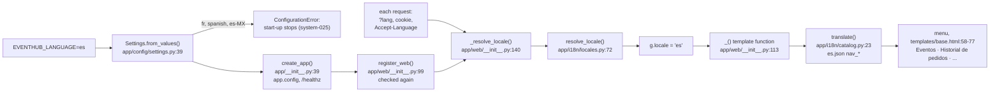

# Part 7, Deliverable 2: How the GenAI tool was used to find the code that had to change

**CEN 4020 AI Project, Part 7 (Configuration Management) · Team: Ian Koratsky, Minh Tam Nguyen**

Part 7 asks us to trace a requirement ("the program can be configured to run in English or Spanish; when Spanish is selected the top-level menu is in Spanish") to the specific code that implements it, so that the configuration change can be made safely. This report covers how we used the GenAI tool to do that tracing, what it found, where it was wrong, and how we checked it. What changed is listed in [Deliverable 1](part7-1-spanish-interface-changes.md).

## Summary

- **The tool turned one request into five tracing questions:** where the menu is; who decides the language; where else English reaches the screen; which tests depend on the current English; and which documents must change first.
- **It used three kinds of tracing, each covering a different gap:**
  1. a code knowledge graph (graphify) for "what calls what";
  2. a scanner it wrote for this job, for "where is visible English";
  3. a requirement tracer it wrote, for "which code and tests name this requirement".
  Each answer was checked by reading the code, because the graph and the scanner were both wrong at first (see "What the tool got wrong").
- **What the tracing found.** The Spanish menu already existed: Part 6 had built it for visitors who ask for Spanish. What was missing was a *configuration*. There was no setting, and English was hard-coded as the fallback. The scanner also found **96 pieces of untranslated English** in 6 templates and `app/web/__init__.py`, and 22 sentences raised by the services.
- **Result:** `EVENTHUB_LANGUAGE=es` runs the whole site in Spanish (system-024 to system-027, ADR-011, release 1.4.0). After the change the scanner finds **0** untranslated texts in templates and the web layer. 7 service sentences are shown in Spanish by their error code, and 15 input-dependent sentences stay English by decision.
- **Verified locally, in every layer** (Part 6 could not do this):

  | Suite | Before (1.3.0) | After (1.4.0) |
  |---|---|---|
  | Unit, contract, process and PostgreSQL tests | 422 passed, 0 skipped | 545 passed, 0 skipped |
  | Selenium system test runs | 87 of 87 | 93 of 93 |

  We also ran a mutation check (break the feature on purpose and watch the tests fail) and a restore drill of `v1.3.0`.

## Tools

| What | Tool |
|---|---|
| Analysis, tracing, code, tests, documents | Claude Code (Anthropic Claude Opus 5.5), working in the repository with a shell, file editing and a browser driver |
| Structural tracing ("what calls what") | graphify: a knowledge graph of the code (`graphify explain`, `graphify affected`, `graphify path`) |
| Text tracing ("where is visible English") | `scripts/find_untranslated_text.py`, written by the tool for this part |
| Requirement tracing ("what names system-026") | `scripts/trace_requirement.py`, written by the tool for this part |
| Exact text search | ripgrep / grep |
| Checks | pytest (with PostgreSQL 16 in Docker), Selenium with headless Chrome, ruff, `check_requirement_coverage.py --strict`, `check_spec_alignment.py`, `structurizr/structurizr validate` |

## What we asked the tool

Our prompts are in Appendix A, word for word. In short: check the branch and the two assignment PDFs, then "examine the repo carefully and follow what week 7 has to do". The tool turned the Part 7 assignment into five tracing questions and answered them in order:

| # | Question | Answered by |
|---|---|---|
| Q1 | Where is the top-level menu, and where does its text come from? | knowledge graph, then reading `templates/base.html` |
| Q2 | Who decides the language today, and where should a setting come in? | knowledge graph, then reading `Settings`, `create_app`, `register_web` |
| Q3 | Where else does English reach a Spanish reader? | the scanner |
| Q4 | Which tests depend on today's English, and which tests must be added? | grep counts, `graphify affected` |
| Q5 | Which requirements, decisions and models must change first? | the existing requirements, ADR-010 and `workspace.dsl`; the process rule system-023 |

## Step 0: Establish where we are before tracing

Before tracing anything, the tool checked that the starting point was what the documents said it was. Three things were not:

| The documents said | What the tool found | What we did |
|---|---|---|
| Part 5 is tagged `v1.2.0` and Part 6 will be `v1.3.0` (system-018) | `git tag` and `git ls-remote --tags` both returned nothing: **neither tag existed** | Created `v1.2.0` (`ede191a`) and `v1.3.0` (`2a39d28`) on the commits whose GitHub Actions runs were green (run ids in the tag messages). We noticed that `v1.2.0`'s `pyproject.toml` says `0.1.0`: the release names in the Call 6 story were mapped onto commits afterwards. |
| `IMPLEMENTATION_STATUS.md`: the Part 6 work is "planned" | The code was merged, and the GitHub Actions *CI* and *System tests* runs on `main` were green | Status and acceptance matrix updated, citing the runs |
| Part 6: the PostgreSQL and Selenium layers had "not been run" on the development machine | Docker and Chrome are now available | We ran **every layer** before touching anything: 422 passed with 0 skipped, and 87 of 87 Selenium runs. This baseline is what "still passes" is measured against. |

The two assignment PDFs were also compared, because a classmate had said Parts 6 and 7 were swapped. Each title matches its content. Pages 3 to 5 of both files are the same Call 6 transcript, word for word (text extracted and diffed). That transcript is titled "Call 6: Maintenance" and contains Darnell's Spanish request, which explains the confusion.

## Step 1: Trace the menu and the language decision with the code graph (Q1, Q2)

**The map was older than the code.** The graph had been built on 3 November, before Part 6 added localization (9 November). Queried as it was, it would have traced the menu to code that no longer existed. The first step was therefore `graphify update .`, which rebuilt it with 2,412 nodes and 6,028 edges. Lesson: check the date of the map before trusting it.

Queries and what they told us (full output in `docs/evidence/part7/trace/01-explain.txt` and `02-explain-affected.txt`):

| Query | What it told us | What we did with it |
|---|---|---|
| `graphify explain "base.html"` | `base.html` holds "Primary navigation" (line 58), and all 11 page templates extend it | The menu is in one place; the template itself needed no change |
| `graphify explain "translate"` | `translate()` (`app/i18n/catalog.py` line 23) is called by `register_web()` at the line that installs the template function `_()` | The menu text comes from the catalogs through `_()` |
| `graphify explain "app_web_init_resolve_locale"` | `_resolve_locale()` runs before every request and calls `resolve_locale()` and `match_tag()` | **This is where the language is decided, and where the setting must enter** |
| `graphify explain "resolve_locale"` | "Ambiguous: matches 2 nodes": `app/i18n/locales.py` and `app/web/__init__.py` | Two functions with almost the same name. We used the node id, and we were careful not to edit the wrong one |
| `graphify explain "register_web()"` | Called by `create_app()` **and** by `create_web_app()` | A second way to build the app that bypasses `Settings`. So the setting is checked in both places (ADR-011 decision 4). Without this the contract-test app could carry an unchecked value. |
| `graphify affected "app/i18n/locales.py"` and `".../app/web/__init__.py"` | Every file and test that depends on them: `test_i18n.py` (3 tests named), `test_api_v1_routes.py`, `test_yen_under_localization.py`, `test_end_to_end.py`, `test_main_program.py`, `test_project_process.py`, and every template form | The tests to run first after each change, and the reason the yen test (system-023) had to stay in the loop |

**What the graph could not see.** It has no edge from `_('nav_events')` in a template to the `nav_events` entry in `es.json` (JSON files have no symbols), and it does not know which strings people can read. Those links came from reading `base.html` and the catalogs, and from the scanner in Step 2.

Put together, the trace from the setting to the menu, as built (file:line after the change):

## Step 2: Find every piece of visible English (Q3)

A Spanish menu above an English page is not a Spanish version. We needed a complete list of English a reader can see. `grep` alone could not produce it: it cannot tell a sentence ("Account created.") from an error code (`"bad-request"`), a header name, a log message or CSS, and it cannot see text between HTML tags.

So the tool wrote **`scripts/find_untranslated_text.py`**:
- **Templates:** it removes every `{{ }}`, `` and `{# #}`, parses the HTML, and lists the text between tags plus the visible attributes (`placeholder`, `aria-label`, `title`, `alt`). The brand name and 3-letter currency codes are allowed.
- **`app/web/*.py`:** it parses the Python and lists string literals that read like sentences, ignoring docstrings.
- **`--all`:** it also lists the sentences the services raise, labelled *shown by code* or *stays English*.

**Run on release 1.3.0, before any change** (`docs/evidence/part7/trace/05-scanner-before.txt`):

| File | Untranslated texts |
|---|---|
| `app/web/__init__.py` | 35 (flash messages, purchase outcomes, error pages) |
| `templates/account.html` | 15 |
| `templates/admin_audit.html` | 14 |
| `templates/admin_rates.html` | 13 |
| `templates/register.html` | 10 |
| `templates/login.html` | 7 |
| `templates/error.html` | 2 |
| **Total in templates and the web layer** | **96** |
| Service sentences (`wiring.py`, `identity`, `admin`, `web/services.py`) | 22 |

The six templates the already-translated Part 6 pages were missing, and every hard-coded message, became the work list. **After the change** (`06-scanner-after.txt`), templates and the web layer have 0. Of the 22 service sentences, 7 are now shown in the page language by their error code, and 15 stay English (input-dependent; ADR-011 decision 6). The scanner is kept as a unit test (`test_untranslated_text_guard.py`), so new English in a template fails the build.

The first version of the scanner was wrong in four ways. Each was found by reading its output against the files:

1. It **crashed** on Windows printing "→" (the console used cp1252). It now writes UTF-8.
2. It reported text that follows a Jinja tag **one line too early**. It now counts the newlines before the text.
3. It flagged `<strong>USD</strong>` in an already-translated page as English. A currency code is an identifier, so 3-letter codes are now allowed.
4. It **missed** the identity service's sentences, which are written in lower case ("password must be at least 8 characters") and only capitalised later by the wiring. The service scan now accepts lower case.

## Step 3: Trace the configuration path (Q2, continued)

Reading `Settings.from_values()` showed that every setting is already read there from the environment, and that a bad value of `EVENTHUB_RESET_ENABLED` already raises `ConfigurationError` at start-up. So the tool proposed putting the language there, with the same "refuse to start" behaviour. This matches the Call 6 lesson about silent defaults: `EVENTHUB_LANGUAGE=spanish` silently meaning English would put a "Spanish" site live in English.

Three decisions came out of the trace. We, not the tool, made them, and they are recorded in ADR-011:

| Decision | Options the tool laid out | What we chose and why |
|---|---|---|
| Where the setting sits in the precedence | before `?lang`; between cookie and `Accept-Language`; after `Accept-Language` | Between them. After `Accept-Language`, the setting would do nothing for most browsers. Before `?lang`, a reader who needs English would be stuck. |
| How strict | accept `es-MX` as `es`, or not | Not. An operator setting should be exact; regional tags stay a browser concern. |
| Scope of service messages | translate all 22; none; or those with a fixed sentence | Fixed sentences only (7), by error code at the web boundary. The rest need the identity and admin services to return codes: a separate change. |

## Step 4: Trace the impact on the tests (Q4)

**Which tests pin today's English?** The tool counted the test files that contain each sentence it was about to move (`grep -rl`): "Invalid email or password." in 2 files, "logged out" in 3, "Account created" in 1, "Administrators only." in 1, "already exists" in 1, and so on. Conclusion: the English had to stay **word for word**. We moved each sentence into `en.json` unchanged, and added a test that compares them with release 1.3.0's sentences. We also added a test that the catalog's English for each error code is the sentence the service actually raises, so the two cannot drift apart.

**How do the Selenium tests find things?** By English labels: `click_button("Create account")`, `"Account created" in flash`. So:
- the existing 87 runs keep using the server that is not configured, in English, and did not need to change;
- the new Spanish tests find fields by id and buttons by form;
- the browser's language is now pinned to English (`make_driver(accept_language="en-US,en")`). That closes a known limit Part 6 had listed: "Selenium tests assume an English default browser".

**Which tests had to be added?** One or more per new requirement, at every level: unit, contract (14 pages in Spanish, with the same pages in English as a control), main program, and six Selenium cases (ST-71 to ST-76). The Selenium cases start a second EventHub with `EVENTHUB_LANGUAGE` set, as an operator would. `check_requirement_coverage.py --strict` confirms every testable requirement is named by a test.

## Step 5: Trace each requirement to code and tests (the result)

The tool also wrote **`scripts/trace_requirement.py`**. Given a requirement id, it lists every file in the code, the tests and the documents that names it, including short forms such as `system-020/024` and `system-020..023`. Run on our own work, it found a gap: **no application file named system-026.** The menu in `base.html` implemented it but did not say so. We added the requirement tags (`{# system-026 ... #}` at the menu, `system-027` on each translated template). A test now fails if any Part 7 requirement is not named by the code that implements it (`tests/test_trace_requirement.py`). Full output: `docs/evidence/part7/trace/09-trace-requirement-part7.txt`.

| Requirement | Design | Code | Tests |
|---|---|---|---|
| system-024 configured language | ADR-011 decisions 1, 3, 4, 9 | `app/config/settings.py:23,39`; `app/i18n/locales.py:52,72`; `app/__init__.py:39,58`; `app/web/__init__.py:99,140` | `test_configured_language.py` (values, precedence, allowlist); `test_spanish_interface.py` (menu, browser, visitor choice); `test_main_program.py` (environment, `/healthz`); ST-71, ST-73, ST-74 |
| system-025 wrong value stops start-up | ADR-011 decision 2 | `app/config/settings.py:50`; `app/i18n/locales.py:52`; `app/web/__init__.py:99` | `test_main_program.py::test_an_unsupported_language_stops_start_up` (6 values); `test_configured_language.py` (9 values); contract (3 values) |
| system-026 top-level menu in Spanish | ADR-011 decision 5 | `templates/base.html:58-77`; `app/i18n/es.json` `nav_*` | contract: guest, buyer, admin menus; ST-71, ST-72 |
| system-027 every page and message in Spanish | ADR-011 decisions 5 to 8 | 6 templates; `app/web/__init__.py` `OUTCOME_ERRORS` (47), `SERVICE_ERROR_KEYS` (74), `_t()` (152), `_localized()` (157); catalogs 171 keys | contract: 14 pages, every outcome, flashes, errors; English unchanged; guard test; ST-75, ST-76 |

## Verification

| Check | Before (1.3.0, `2a39d28`) | After (1.4.0, `eventhub/part7`) |
|---|---|---|
| Unit, contract, process and PostgreSQL tests (`pytest -rs` with a database) | 422 passed, 0 skipped | **545 passed, 0 skipped** |
| Selenium system tests (`python scripts/run_system_tests.py`) | 87 of 87 passed | **93 of 93 passed** (87 unchanged and 6 new) |
| Untranslated texts in templates and `app/web` | 96 | **0** |
| Catalog keys (each language) | 78 | 171 |
| Lint, format, requirement coverage `--strict`, spec alignment | pass | pass |

Logs: `docs/evidence/part7/` (`pytest-before.log`, `system-before.log`, `pytest-after.log`, `system-after.log`, `system-tests-after.html`).

**Do the new tests actually detect a broken feature?** Passing tests prove little if they could never fail. The tool deliberately broke the feature: in `resolve_locale()` it moved `Accept-Language` in front of the configured language, so the browser would win, the exact behaviour system-024 forbids. **34 unit and contract tests failed, and so did ST-71 and ST-73 in the browser.** With the real code restored they pass (`trace/07-mutation-check.txt`).

**Is the previous release still restorable?** We checked out `v1.3.0` in a separate worktree and ran its own unit and contract suite (`restore-drill-v1.3.0.log`). Release 1.4.0 adds no database migration, so rolling back is code only. The runbook now warns that 1.3.0 ignores `EVENTHUB_LANGUAGE`: after a rollback, a Spanish deployment shows each browser its own language.

**Is the model valid?** `workspace.dsl` (Operator, `PostCall7` views) passes `structurizr/structurizr validate` (exit 0). We first used the older `structurizr/cli` image, which returned exit 0 for a copy with a deliberately broken relationship as well. That image is deprecated: it prints a banner and checks nothing. The new image rejects the broken copy with exit 1 and names the line. The lesson is the same as the mutation check: test the check before trusting its "pass".

**Screenshots** of the same four pages from an English-configured and a Spanish-configured server, with a browser that asks for English: `docs/evidence/part7/screenshots/` (`es-healthz.json` shows `"language": "es"`, `"version": "1.4.0"`).

**Not yet done:** the GitHub Actions run for this branch (it runs on push), the `v1.4.0` tag (after merge and a green run), pushing the `v1.2.0` and `v1.3.0` tags, and the teammate review that `CONTRIBUTING.md` requires for AI-written code.

## What the tool got wrong, and what needed a human decision

| # | What happened | How it was caught | Effect |
|---|---|---|---|
| 1 | The code graph was a week older than the code | Its date was checked before any query | Rebuilt first; otherwise the trace would have pointed at pre-Part-6 code |
| 2 | Four scanner bugs (crash, line numbers, `USD`, lower-case sentences) | Reading its output against the files | Fixed before the inventory was trusted |
| 3 | The old Structurizr image "validated" a broken model | A planted error | Switched to the maintained image |
| 4 | A new contract test asserted "no cookie is set" on a Spanish page. The page correctly sets a session cookie for its form token | The test failed; the cookie was read | The test was wrong, not the app. It now checks only the language cookie |
| 5 | A test loaded the scanner in a way Python's dataclasses do not support | The test errored | Loader fixed |
| 6 | The project's own documents claimed tags and "planned" work that did not match reality | `git tag`, GitHub Actions history | Tags created, status corrected |
| 7 | In the Spanish screenshots, amounts read `24,84 EUR` but exchange rates still read `0.92` | Looking at the screenshot | Left on purpose: the admin rate form only accepts `.`, and showing `0,92` next to an input that rejects it invites a typo. Recorded as a known limit. |

The decisions in Step 3 (precedence, strictness, scope), the release number, and publishing the tags were ours. The tool laid out the options and their consequences, but did not decide them.

## How to repeat this for the next configuration change

1. Find the requirement: `python scripts/trace_requirement.py <id>` lists the code, tests and documents that name it.
2. Refresh the map, then ask it: `graphify update .`, then `graphify explain "<function>"` and `graphify affected "<file>"`. Run the listed tests first.
3. For anything a person reads: `python scripts/find_untranslated_text.py --all`.
4. Write the requirement and the decision before the code (system-023), mark undecided values `[TEMPORARY_MVP_DEFAULT]` or `[OPEN]`.
5. Prove the tests can fail (break the feature once on purpose), run every layer, and keep the logs.

## Appendix A: the prompts

Our prompts to the tool in this session, word for word (typing errors included):

1. "see what cod branhc are we on, are we on latest main, then see if we alreayd did 6 and have we done ai project 7, btoh reuqirmenet file can find on download"
2. "can you check actually content, my firiend idk why he said part 7 is actually part 6 and part 6 actually part 7???"
3. "so we still need to do 7 right?"
4. "yes., exmaine the erpeo carefully and follow what sweek 7 have to do"

Everything after prompt 4 (the five questions, the tracing, the tools, the changes and the checks) was planned and carried out by the tool, with the decisions in Step 3 recorded for our review.

## Appendix B: evidence

| Item | Where |
|---|---|
| Graph queries before the change | `docs/evidence/part7/trace/01-explain.txt`, `02-explain-affected.txt` |
| grep inventories of messages | `trace/03-visible-english-web.txt`, `04-visible-english-services.txt` |
| Scanner before and after | `trace/05-scanner-before.txt`, `06-scanner-after.txt` |
| Mutation check | `trace/07-mutation-check.txt` |
| Graph queries after the change | `trace/08-graph-after.txt` |
| Requirement trace, system-024 to system-027 | `trace/09-trace-requirement-part7.txt` |
| Test runs before and after | `docs/evidence/part7/pytest-before.log`, `system-before.log`, `pytest-after.log`, `system-after.log`, `system-tests-after.html` |
| Restore drill | `docs/evidence/part7/restore-drill-v1.3.0.log` |
| Screenshots | `docs/evidence/part7/screenshots/` |
| Commits | `af501d7` (spec), `0abe270` (tracing tools), `ea06439` (code), `49c416b` (tests), then documents and evidence |
