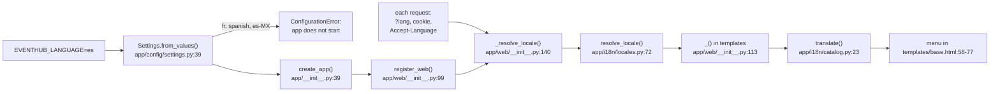

# Part 7, Deliverable 2: How we used the GenAI tool to find the code that had to change

**CEN 4020 AI Project, Part 7 (Configuration Management) · Team: Ian Koratsky, Minh Tam Nguyen**

For Part 7 the customer wants EventHub to be configurable to run in English or Spanish, with the top-level menu in Spanish when Spanish is selected. To make that change safely we first had to trace the requirement to the code that implements it. This report explains how we used the GenAI tool for that tracing, what it found, where it got things wrong, and how we checked the result. The list of changes is in [Deliverable 1](part7-1-spanish-interface-changes.md).

## Summary

We gave the GenAI tool the assignment and the repository and asked it to work out what Part 7 needed. It broke the job into five questions:

1. Where is the top-level menu, and where does its text come from?
2. Who decides the language today, and where should a setting go?
3. Where else does English show up on the screen?
4. Which tests depend on the current English text?
5. Which requirements and design documents have to change first?

It answered them with three kinds of tracing. A code graph (graphify) showed what calls what. A scanner it wrote for this part listed visible English. A requirement tracer, also written for this part, lists the code and tests that name a requirement.

The main finding was that the Spanish menu already existed: Part 6 built it for visitors who pick Spanish themselves. What was missing was a way to configure the whole program. There was no setting, and English was hard-coded as the fallback. The scanner also found 96 pieces of untranslated English in six templates and in the web routes.

After the change, `EVENTHUB_LANGUAGE=es` runs the whole site in Spanish (requirements system-024 to system-027, ADR-011, release 1.4.0). All tests pass:

| | Before (release 1.3.0) | After (release 1.4.0) |
|---|---|---|
| Unit, contract, process and PostgreSQL tests | 422 passed, 0 skipped | 545 passed, 0 skipped |
| Selenium system tests | 87 of 87 | 93 of 93 |
| Untranslated English in templates and web routes | 96 | 0 |

## Tools

| Purpose | Tool |
|---|---|
| Tracing, code changes, tests, documents | The GenAI tool, an AI coding assistant that could read the repository, run commands and edit files |
| What calls what | graphify, a knowledge graph of the code (`explain`, `affected`, `path`) |
| Where English appears | `scripts/find_untranslated_text.py` (written for this part) |
| Which code names a requirement | `scripts/trace_requirement.py` (written for this part) |
| Checks | pytest with PostgreSQL 16 in Docker, Selenium with headless Chrome, ruff, the requirement-coverage and spec-alignment scripts, Structurizr |

## Step 0: Checking the starting point

Before tracing anything, the tool checked that the repository matched what our own documents said. It found three things that didn't:

- **Missing tags.** The Part 6 documents said Part 5 was tagged `v1.2.0` and Part 6 would be `v1.3.0`, but neither tag existed, locally or on GitHub. We created them on the two commits whose GitHub Actions runs had passed. One oddity: `pyproject.toml` at `v1.2.0` says version `0.1.0`, because the release names come from the Call 6 story and were matched to commits afterwards.
- **Stale status.** `IMPLEMENTATION_STATUS.md` still listed the Part 6 work as "planned", even though it was merged and CI was green. We corrected it.
- **Untested layers.** In Part 6 we could not run the PostgreSQL and Selenium tests on our machine. This time Docker and Chrome were available, so we ran every test layer before changing anything (422 passed, 87 of 87 Selenium). That run is the baseline for "it still passes".

We also compared the two assignment PDFs, because a classmate thought Parts 6 and 7 were swapped. They are not. Both PDFs include the same Call 6 transcript on pages 3 to 5. That transcript is titled "Call 6: Maintenance" and contains Darnell's request for Spanish, which is probably where the confusion came from.

## Step 1: Tracing the menu and the language choice with the code graph

The code graph had been built on 3 November, before Part 6 added the Spanish code on 9 November. Used as it was, it would have pointed us at code that no longer existed. So the first step was to rebuild it (`graphify update .`, 2,412 nodes and 6,028 edges).

These were the queries that mattered (full output in `docs/evidence/part7/trace/01-explain.txt` and `02-explain-affected.txt`):

| Query | What it showed | What we did with it |
|---|---|---|
| `explain "base.html"` | The menu ("Primary navigation") is in `base.html`, and all 11 pages extend it | The menu lives in one file |
| `explain "translate"` | `translate()` in `app/i18n/catalog.py` is called where `register_web()` sets up the template function `_()` | The menu text comes from the language files through `_()` |
| `explain "_resolve_locale"` | It runs before every request and picks the language | This is where the new setting had to be used |
| `explain "resolve_locale"` | Two functions match this name, in `app/i18n/locales.py` and in `app/web/__init__.py` | We made sure to change the right one |
| `explain "register_web()"` | It is called by `create_app()` and by `create_web_app()` | There are two ways to build the app, and only the first goes through `Settings`. So the setting is checked in both places. |
| `affected "app/i18n/locales.py"` and `affected "app/web/__init__.py"` | The files and tests that depend on them, including the yen test from Part 6 | These were the tests we ran first after every change |

The graph could not answer everything. It has no link from `_('nav_events')` in a template to the `nav_events` entry in `es.json`, and it cannot tell which strings a user sees. We filled those gaps by reading `base.html` and the language files, and with the scanner in Step 2.

The full path from the setting to the menu text:

## Step 2: Finding every piece of visible English

A Spanish menu above English pages would not count as a Spanish version, so we needed a complete list of the English a user can see. Plain `grep` was not enough. It cannot tell a sentence like "Account created." from an error code, a header name or a log message, and it does not understand HTML.

So the GenAI tool wrote `scripts/find_untranslated_text.py`:

- **Templates:** it removes the Jinja tags and lists the text between HTML tags, plus the visible attributes (`placeholder`, `aria-label`, `title`, `alt`).
- **Web routes:** it reads the Python code and lists string literals that look like sentences.
- **Services (with `--all`):** it also lists the sentences the services raise, and says whether each one is translated by its error code or stays in English.

On release 1.3.0, before any changes, it found 96 untranslated texts (`trace/05-scanner-before.txt`):

| File | Count |
|---|---|
| `app/web/__init__.py` | 35 |
| `templates/account.html` | 15 |
| `templates/admin_audit.html` | 14 |
| `templates/admin_rates.html` | 13 |
| `templates/register.html` | 10 |
| `templates/login.html` | 7 |
| `templates/error.html` | 2 |

It also listed 22 sentences raised by the services. That list became our work list. After the change the scanner finds 0 in templates and web routes (`trace/06-scanner-after.txt`). Of the 22 service sentences, 7 are now shown in Spanish by their error code, and 15 stay English (see Step 3). We kept the scanner as a unit test, so any new hard-coded English fails the build.

The first version of the scanner had four bugs, which we found by comparing its output with the files:

1. It crashed on Windows when printing an arrow character.
2. Text right after a Jinja tag got the wrong line number.
3. It flagged the currency code `USD` as English.
4. It missed the identity service's messages, because they are written in lower case.

All four were fixed before we relied on the list.

## Step 3: Tracing where the setting should go

Reading `Settings.from_values()` showed that every other `EVENTHUB_*` setting is read there, and that a bad value of `EVENTHUB_RESET_ENABLED` already stops the app at start-up. So the language setting went there too, with the same behaviour. This matches what we learned from Call 6: a wrong value that silently becomes a default (like yen being treated as having two decimals) is worse than an app that refuses to start.

The tool had to make three decisions while doing this. Each is written down in ADR-011 with its reasons, so we can review or change it:

| Decision | Options | Chosen, and why |
|---|---|---|
| Where the setting goes in the order of precedence | Before `?lang`; between the cookie and the browser language; or after the browser language | Between the cookie and the browser language. If it came after the browser language it would almost never take effect, because most browsers ask for English. If it came before `?lang`, a reader who needs English on the Spanish site would have no way out. |
| How strict to be | Accept `es-MX` as `es`, or not | Not. An operator's setting should be exact. |
| Which service messages to translate | All 22; none; or the ones that are always the same sentence | The 7 fixed sentences, translated by error code. The other 15 are built from the input inside the account and exchange-rate code, and translating them would mean changing those modules to return codes. That is a separate change. |

## Step 4: Tracing the effect on the tests

To see which tests depend on the current English, the tool counted the test files containing each sentence it was about to move. For example, "Invalid email or password." appears in 2 files, "logged out" in 3, and "Account created" in 1. So the English had to stay exactly the same. We moved each sentence into `en.json` unchanged, and added a test that compares them with the 1.3.0 wording.

The Selenium tests find buttons by their English labels (for example `click_button("Create account")`). For that reason:

- the 87 existing tests keep running against an English server and did not need to change;
- the new Spanish tests find fields by id instead of by label;
- the browser language is now fixed to English in the test setup, which removes a limitation we listed in Part 6.

We added tests at every level for the new requirements: unit, contract, main program, and six Selenium tests (ST-71 to ST-76). The Selenium tests start a second copy of EventHub with `EVENTHUB_LANGUAGE` set, the same way someone deploying it would.

## Step 5: Tracing each requirement to its code and tests

The tool also wrote `scripts/trace_requirement.py`. You give it a requirement id and it lists every file in the code, tests and documents that names it, including short forms like `system-020/024`.

When we ran it on our own work, it showed that no application file named system-026, even though `base.html` implements it. We added requirement comments to the menu and to the translated templates, plus a test that fails if a Part 7 requirement is not named by the code that implements it. The full output is in `trace/09-trace-requirement-part7.txt`.

| Requirement | Design | Code | Tests |
|---|---|---|---|
| system-024: the setting chooses the language | ADR-011 decisions 1, 3, 4 and 9 | `app/config/settings.py`, `app/i18n/locales.py`, `app/__init__.py`, `app/web/__init__.py` | `test_configured_language.py`, `test_spanish_interface.py`, `test_main_program.py`; ST-71, ST-73, ST-74 |
| system-025: a wrong value stops start-up | ADR-011 decision 2 | `app/config/settings.py`, `app/i18n/locales.py` | `test_main_program.py`, `test_configured_language.py` |
| system-026: Spanish top-level menu | ADR-011 decision 5 | `templates/base.html` lines 58 to 77, `nav_*` in `es.json` | Contract tests for the guest, buyer and admin menus; ST-71, ST-72 |
| system-027: every page and message in Spanish | ADR-011 decisions 5 to 8 | Six templates, `app/web/__init__.py`, and the language files (171 entries each) | 14 pages checked in Spanish, message tests, the scanner test; ST-75, ST-76 |

## Verification

| Check | Before | After |
|---|---|---|
| Unit, contract, process and PostgreSQL tests | 422 passed, 0 skipped | 545 passed, 0 skipped |
| Selenium system tests | 87 of 87 | 93 of 93 |
| Untranslated English in templates and web routes | 96 | 0 |
| Lint, requirement coverage, spec alignment | pass | pass |

The logs are in `docs/evidence/part7/`.

**Mutation check.** To check that the new tests can actually fail, we broke the feature on purpose: the browser's language was made to win over the setting. 34 unit and contract tests failed, and so did Selenium tests ST-71 and ST-73. With the real code back, they all pass (`trace/07-mutation-check.txt`).

**Restore drill.** We checked out `v1.3.0` in a separate folder and ran its own tests (371 passed). Release 1.4.0 has no database migration, so rolling back only means switching the code. The runbook notes that 1.3.0 ignores `EVENTHUB_LANGUAGE`, so after a rollback a Spanish deployment would follow each visitor's browser language again.

**Model check.** We validated `workspace.dsl` with Structurizr. The first validator we tried, the old `structurizr/cli` image, also "passed" a copy we had broken on purpose. That image is no longer maintained and does not actually check the file. The current `structurizr/structurizr` image rejects the broken copy and accepts ours.

**Screenshots** of the same pages from an English-configured server and a Spanish-configured one are in `docs/evidence/part7/screenshots/`.

**Still to do:** the GitHub Actions run for this branch (it runs when we push), the `v1.4.0` tag after merging, pushing the `v1.2.0` and `v1.3.0` tags, and a review of the change by the other team member, as `CONTRIBUTING.md` requires.

## What went wrong along the way

| What happened | How we caught it | Result |
|---|---|---|
| The code graph was older than the code | Checked its date before using it | Rebuilt it first |
| Four bugs in the first version of the scanner | Compared its output with the files | Fixed them before trusting its list |
| The old Structurizr image passed a broken model | Gave it a file we had broken on purpose | Switched to the maintained image |
| A new test wrongly expected no cookie on a Spanish page (the page sets a normal session cookie) | The test failed | The test was wrong, not the app. It now checks only for the language cookie. |
| A test loaded the scanner in a way Python's dataclasses don't support | The test errored | Fixed how it loads |
| Our own documents described tags and "planned" work that didn't match reality | `git tag` and the GitHub Actions history | Tags created, status corrected |
| In the Spanish screenshots, amounts showed `24,84 EUR` but exchange rates still showed `0.92` | Looking at the screenshots | Left on purpose. The admin rate form only accepts a dot, so showing a comma next to it would invite typing mistakes. Recorded as a known limit. |

## How to repeat this for the next configuration change

1. Run `python scripts/trace_requirement.py <id>` to find the code, tests and documents for the requirement.
2. Rebuild the graph (`graphify update .`), then use `graphify explain` and `graphify affected`. Run the tests they list first.
3. For any text a user reads, run `python scripts/find_untranslated_text.py --all`.
4. Write the requirement and the design decision before the code.
5. Break the feature once on purpose to check the tests catch it, run every test layer, and keep the logs.

## Appendix A: what we asked the tool

After checking which branch we were on and which parts were already done, our request was, lightly edited for spelling:

> Examine the repo carefully and follow what week 7 has to do.

From there, the GenAI tool did the tracing and made the changes described in this report. The decisions it had to make are listed in Step 3 and ADR-011.

## Appendix B: evidence

| Item | Where |
|---|---|
| Graph queries before the change | `docs/evidence/part7/trace/01-explain.txt`, `02-explain-affected.txt` |
| grep lists of messages | `trace/03-visible-english-web.txt`, `04-visible-english-services.txt` |
| Scanner before and after | `trace/05-scanner-before.txt`, `06-scanner-after.txt` |
| Mutation check | `trace/07-mutation-check.txt` |
| Graph queries after the change | `trace/08-graph-after.txt` |
| Requirement trace, system-024 to system-027 | `trace/09-trace-requirement-part7.txt` |
| Test runs before and after | `pytest-before.log`, `system-before.log`, `pytest-after.log`, `system-after.log`, `system-tests-after.html` |
| Restore drill | `restore-drill-v1.3.0.log` |
| Screenshots | `docs/evidence/part7/screenshots/` |
